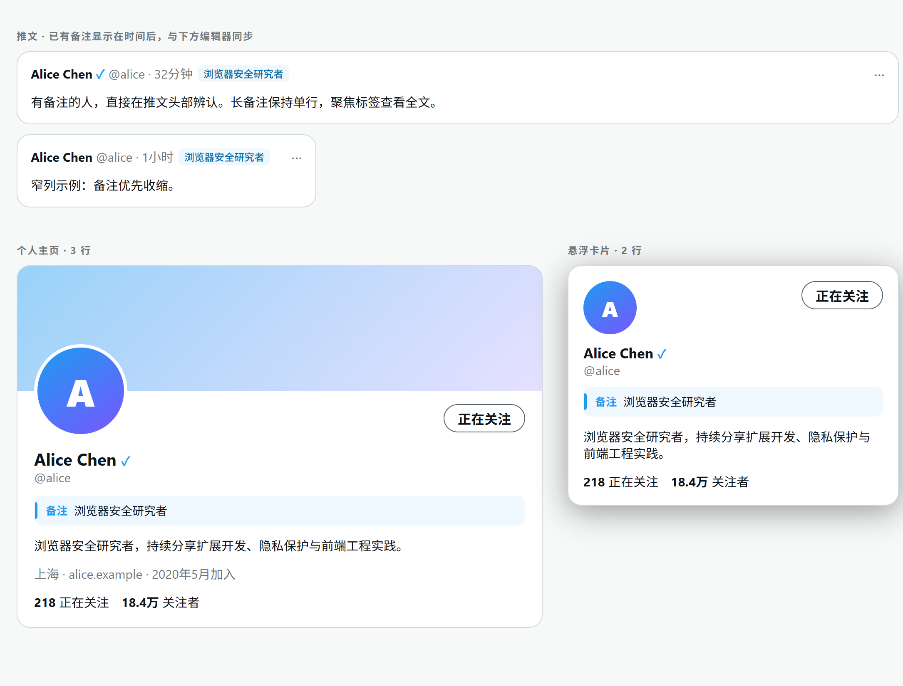
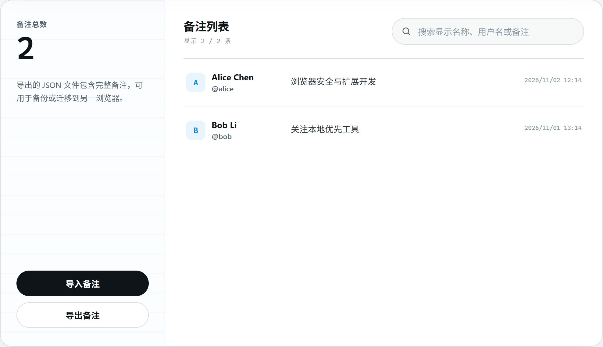
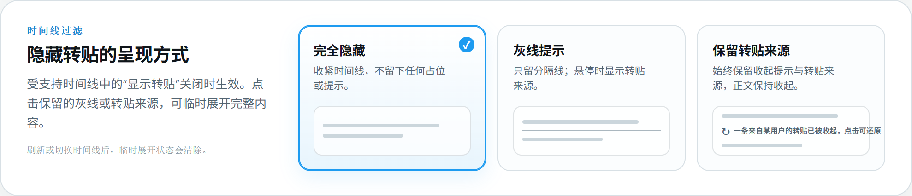
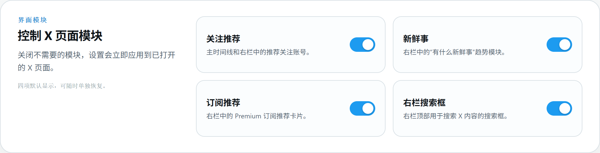
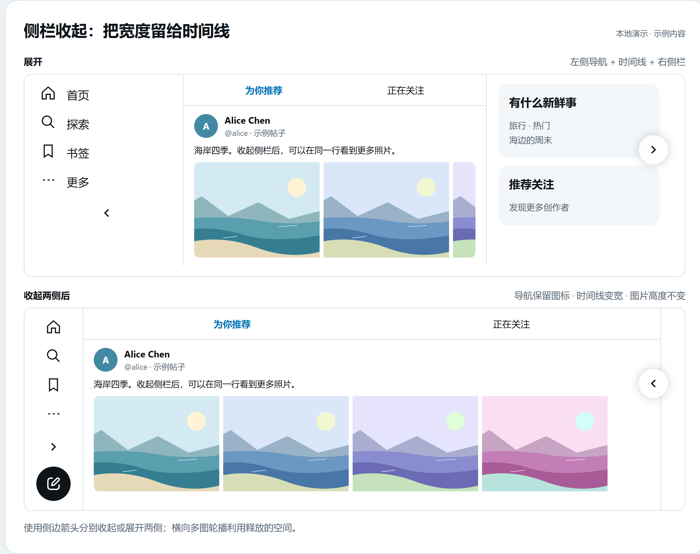
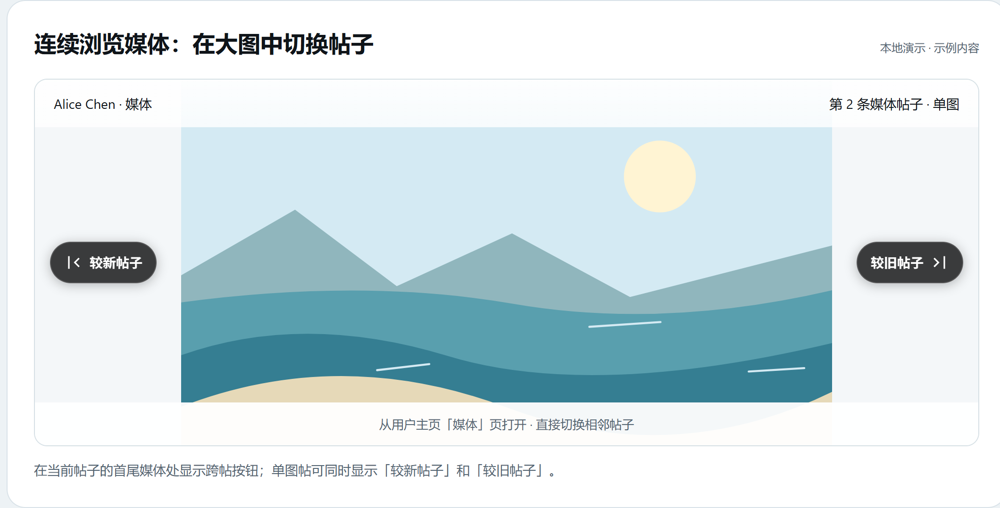
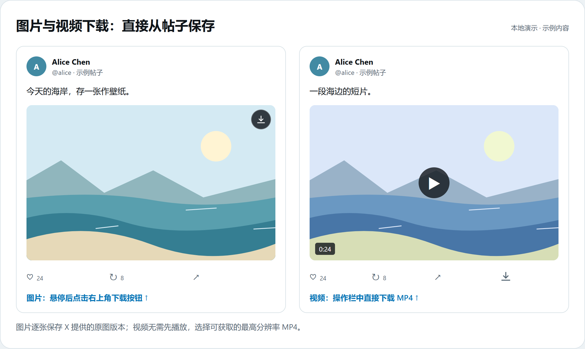
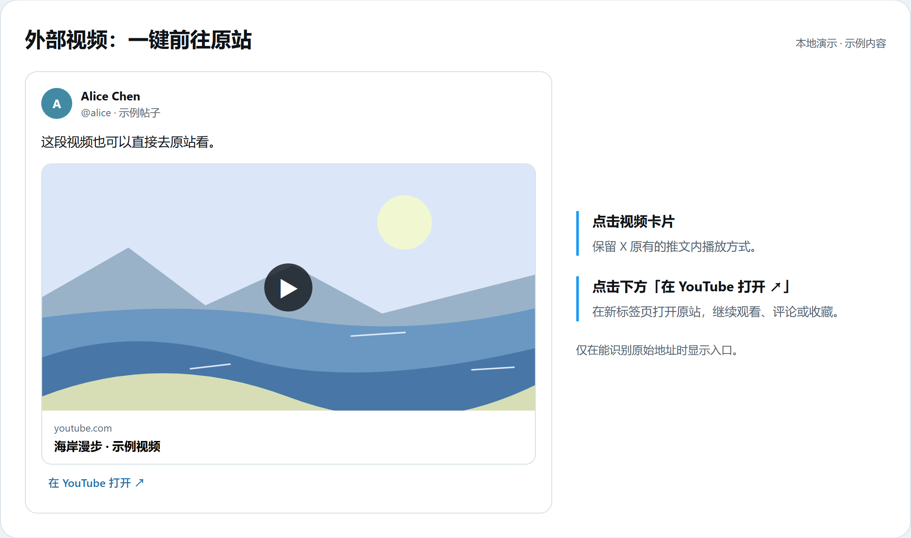

# Twitter Enhancement

为 X / Twitter 添加私人备注、时间线过滤、界面整理和媒体工具的 Chrome / Edge 扩展。记住关注的人，减少浏览干扰，方便地看图和保存媒体。

备注与设置只保存在当前浏览器，不上传、不做云同步。点击浏览器工具栏中的扩展图标，即可打开设置页。

[私人备注](#私人备注) · [搜索与备份](#备注搜索与备份) · [时间线过滤](#时间线过滤) · [界面整理](#界面整理) · [侧栏收起](#侧栏收起) · [连续看媒体](#连续浏览媒体) · [图片与视频下载](#图片与视频下载) · [外部视频](#外部视频直达原站)

> 配图统一使用亮色主题，来自项目的本地预览与示例数据；实际位置随 X 页面布局而变化。

## 私人备注

**记住一个人为什么值得关注。** 给账号记下身份、兴趣或关注原因，刷到帖子时就能认出对方。

在个人主页或头像悬浮卡片中，点击 `@用户名` 下方的「无备注」或已有备注，输入后保存；再次点击即可修改或删除。

已有备注会自动出现在推文、引用推文及详情页的作者信息旁。长备注可悬停、聚焦或点击查看全文，只有自己能看到。



## 备注搜索与备份

**备注多了方便查找，换浏览器时也能带走。**

打开扩展设置，在「备注列表」按显示名称、用户名或备注内容搜索。点击「导出备注」保存 JSON 备份；在另一浏览器中点击「导入备注」恢复。

导入可选择完全替换，或增补并保留同一用户名下较新的备注。完全替换会覆盖当前列表，操作前可先导出备份。



## 时间线过滤

**想多看原创，少看转贴和广告。** 适用于首页、列表页和用户主页的「帖子」时间线。

- **收起转贴**：在时间线第一条推文前关闭「显示转贴」，收起没有附言的纯转贴，保留原创、置顶和带附言的引用贴。默认关闭。
- **选择收起效果**：在扩展设置中选择「完全隐藏」「灰线提示」或「保留转贴来源」。后两种可点击临时展开单条内容，刷新或切换时间线后恢复收起。
- **隐藏广告**：扩展设置中的「隐藏广告」默认开启，直接隐藏带广告或推广标记的推文；与转贴开关独立，不留下展开占位。



## 界面整理

**不想让推荐内容占据视线。** 只保留自己需要的页面模块。

打开扩展设置，在「界面模块」中分别关闭关注推荐、新鲜事、Premium 订阅推荐或右栏搜索框，设置立即生效。其中，关注推荐同时覆盖时间线内的推荐模块和右栏卡片；四项默认显示，可随时恢复。



## 侧栏收起

**把更多宽度留给中间时间线。** 左侧导航与右侧栏可以分别收起。

在 X 页面点击「收起左侧导航」或右侧栏的收起按钮，时间线会使用释放出的空间；再次点击即可展开。

横向多图轮播能同时显示更多图片，保留原有高度；单图、视频和链接预览保持原有尺寸。进入 X 文章后，正文和文章内媒体会使用展开后的主栏宽度。



## 连续浏览媒体

**看完一条帖子的图片，直接接着看下一条。** 无需反复关闭大图、返回媒体网格。

从用户主页的「媒体」页打开照片、GIF 或视频。在当前帖子的第一项或最后一项媒体处，点击出现的「较新帖子」或「较旧帖子」，即可切换到相邻的媒体帖子；需要时会继续加载媒体时间线。



## 图片与视频下载

**看到想保存的内容，直接在帖子里下载。**

| 内容 | 如何使用 |
| --- | --- |
| 图片 | 鼠标悬停在推文图片上，点击右上角的「下载原图」按钮；多图帖子逐张保存，也支持键盘聚焦操作。 |
| X 视频 | 点击视频推文操作栏的「下载视频」按钮，无需先播放；自动选择可获取的最高分辨率 MP4。 |

图片下载使用 X 保存的原图版本，头像、视频封面和链接预览不显示下载按钮。若暂未获取到视频地址，可稍后重试。



## 外部视频直达原站

**想去原站看视频、读评论或收藏。** 在可识别的外部视频卡片下方，点击「在 YouTube 打开 ↗」等入口，即可在新标签页打开原站。

支持识别 YouTube、Vimeo、Dailymotion、哔哩哔哩和 Twitch 等视频链接；无法确定原始地址时不显示入口。点击原卡片仍可在推文内展开播放。



## 安装

当前可从源码构建，再加载到 Chrome / Edge。需要 Node.js 20.12+，使用项目指定的 `pnpm@11.1.3`。

```sh
pnpm install
pnpm build
```

1. 打开 `chrome://extensions` 或 `edge://extensions`，开启「开发者模式」。
2. 点击「加载已解压的扩展程序」，选择项目根目录下的 `dist` 文件夹。
3. 打开或刷新 X / Twitter 页面。将扩展固定到工具栏，方便进入设置。

## 数据与使用范围

- 仅在 `https://x.com/*` 和 `https://twitter.com/*` 页面运行。申请的 `storage` 和 `downloads` 权限用于本地保存数据和下载媒体。
- 备注和设置不上传；下载媒体时会访问 X 的媒体地址，打开外部视频时会前往对应网站。
- 备注按 `@用户名` 关联，用户更改用户名后，旧备注不会自动跟随。导出的文件包含完整备注，请自行保管。
- X 页面结构变化可能影响部分功能；本地预览用于展示组件，不代表真实 X 页面兼容性验证。

<details>
<summary>参与开发</summary>

项目使用 WXT、React、TypeScript 和 Vitest。

```sh
pnpm install
pnpm dev
```

提交修改前运行：

```sh
pnpm typecheck
pnpm test
pnpm build
```

运行 `pnpm preview:ui` 可查看本地组件预览：

- `http://127.0.0.1:4173/`：备注预览。
- `http://127.0.0.1:4173/settings.html`：设置页预览。
- `http://127.0.0.1:4173/features.html`：侧栏对比、连续浏览媒体、下载和外部视频效果演示。

README 配图取自以上页面，使用实际扩展组件与示例内容，不包含真实用户数据。功能演示的下载和外链操作仅模拟反馈，不下载文件或跳转网站；预览用浏览器接口替身仅在 `preview/vite.config.ts` 中启用。

业务功能位于 `src/features/`，X 页面适配位于 `src/platform/x/`，浏览器存储实现位于 `src/shared/storage/`。修改前请阅读 [AGENTS.md](AGENTS.md)。

</details>
